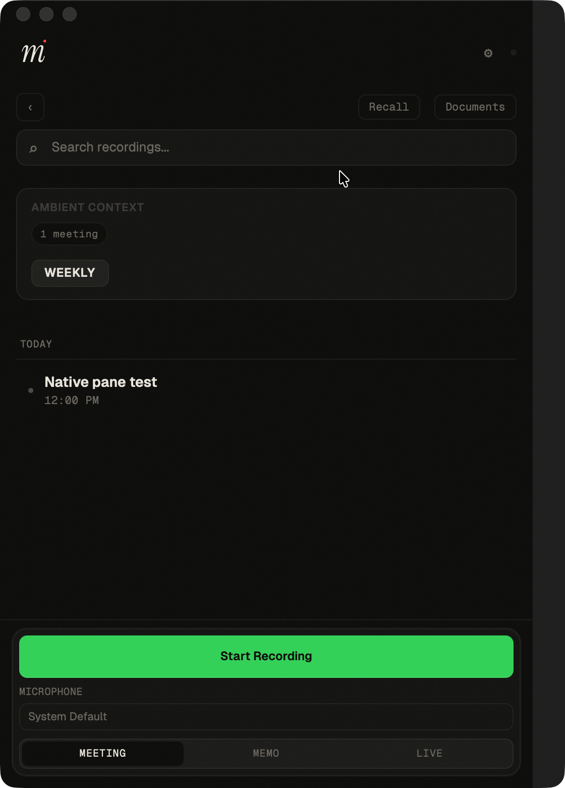

# Narrow pane visibility: signed native verification

Issue: https://github.com/silverstein/minutes/issues/1135

Candidate base: `dea8c4d205c4a6699c52dc2fa382742c3af2758b` (Minutes 0.29.1).
Full tested `tauri/src/index.html` SHA-256:
`e5a66ef88c80ecb0a8d85790e3025e18c7608af20629fee2ef9efb28081e7bee`.

Silverbook's Minutes lane applied the exact patch to a detached QA checkout,
built and installed through `scripts/install-dev-app.sh`, and tested the
canonical `~/Applications/Minutes Dev.app` with synthetic files and an isolated
runtime profile. The source hash matched the implementation lane's candidate;
the native lane made no UI changes and left its test patch uncommitted.

The installed bundle ID was `com.useminutes.desktop.dev`, signed with
`Apple Development: Mathieu Silverstein (97C8UF8QVF)`, team `63TMLKT8HN`.
Strict bundle verification passed, and the hotkey diagnostic returned 0.
The installed executable time was `2026-10-14T20:22:45.382317+00:00`;
fresh installed-app PIDs were 10810, 28882 and 31632. The final PID started at
16:32:44 America/New_York. The implementation lane independently checked the
bundle seal and identity and inspected the saved native screenshots.

| Native check | Result |
| --- | --- |
| Sole primary pane at actual 460, 560, 700 and 900px | Visible; recording controls enabled and inside the window |
| Collapse control with no secondary pane | Disabled |
| Saved collapse preference | Preserved while the sole primary pane stays visible; reapplied when Recall opens |
| Close Recall through its real control | Primary pane restored; the app changed 560x780 to 520x640 without a test resize after closing |
| Open and close the actual document viewer | Primary list and recording controls restored at unchanged 560x780 |
| Manual expansion with Recall open | Works at 960x640 and 700x780 |

The native build launches at 1120x720. True narrow startup is covered by the
browser regression, not claimed as native acceptance. Browser checks execute
the shipped DOM, CSS, pane policy and Recall transitions with stubbed IPC;
the new regression fails on the previous behavior. Native resize and close
checks use the real installed app. Existing 32px collapsed Recall padding and
the friend's old non-interactive terminal are outside this change.

The native lane restored the original collapsed preference to false, closed
Recall/document panes, left the primary pane visible at 900x780 with capture
idle, and released its UI slot and Cua sessions. Its QA checkout remains owned
by that lane at
`/Users/silverbook/Sites/minutes-worktrees/blank-narrow-native-1135-20261014`.

The following capture contains only synthetic test data. It shows the primary
pane after restarting with a saved collapsed preference and resizing to 560px:

