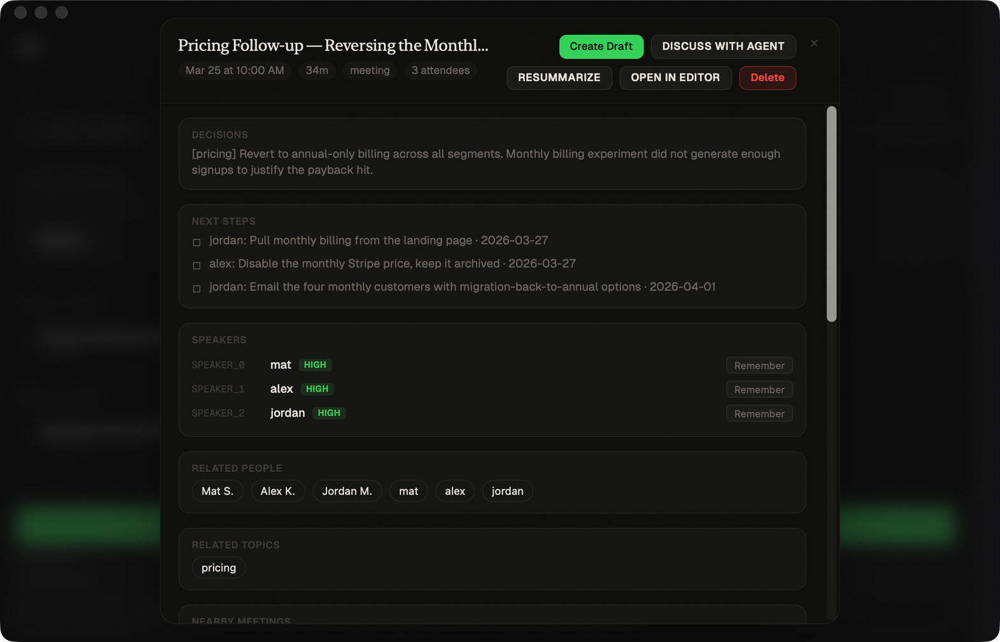
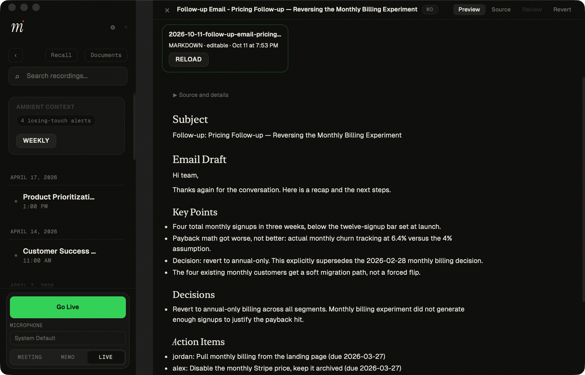

# Completed-meeting and readable-draft verification

This tranche makes completed meetings lead with decisions and next steps, and
makes new drafts open as readable documents. The source editor, paragraph editing,
autosave, source metadata, and snapshot review remain available. Follow-up emails
use date-neutral wording when drafted from older meetings.

## Source and native identity

The source is based on main `d3285c7990e69ff5db36e1691cca43517b232d66` and the
meeting-workflow audit `add00fe1993bf94929c49e195f9f99b6f21bc109`, plus this change.
The tested frontend SHA-256 is
`6a4087ddcda2545c9a04510970008a1b56a55c30765e4c9194178f1326009ad0`.
The tested commands.rs SHA-256 is
`89af460130a248d893604485c02030ae564bfd9cdd593327b5bbe65f6fa8baf7`.

The canonical `scripts/install-dev-app.sh --no-open` ran successfully in a new
Apple Terminal window after the same signing probe succeeded there and failed
over SSH. The installed app was launched directly with a synthetic profile:

- App: `~/Applications/Minutes Dev.app`.
- Bundle: `com.useminutes.desktop.dev`.
- Authority: `Apple Development: Mathieu Silverstein (97C8UF8QVF)`.
- Team: `63TMLKT8HN`; strict deep bundle verification passed.
- Installed executable and new PID 68482 both dated October 11 at 19:51:23 on the Mac.
- Installed hotkey diagnostic exit 0 proves CGEventTap startup only.

The test profile had independent configuration, data, meeting output, and index
paths. Its TOML was validated before launch. Dictation, voice, and global recording
shortcuts were disabled. No recording or playback occurred. The regular Minutes
process, PID 71757, continued running. WebKit preferences are associated with the
Dev bundle, so this is data isolation rather than a separate macOS account.

## Observed behavior

Native Cua inspection and click-tests verified the following:

- The March 25 pricing meeting shows Decisions and Next steps before Speakers.
- Create Draft is the primary action; selecting Follow-up Email creates a
  source-linked file and opens its rendered preview with a readable header title.
- Source and details starts collapsed. Expanding it reveals the original source
  path and March 25 date while staying in preview.
- The follow-up says “Thanks again for the conversation,” without claiming the
  meeting happened today.
- Clicking a rendered paragraph opens its inline editor. Switching to Source
  exposes the full document; switching back restores the rendered preview.
- A native Source edit autosaved a QA sentence. The persisted file retained the
  entire original document as its prefix, including source metadata and facts.
- Review opened its existing Before/Current panel. Revert requested confirmation
  and restored the exact bytes of the latest snapshot.

Revert restores the latest autosave snapshot, which may be an intermediate edit.
It is not a whole-edit-session undo. The existing broader artifact/history work
remains open. Review still presents source text, and the recent-artifact strip
still uses filenames; those are subsequent refinements, not completed here.

## Automated and layout checks

- Seven new frontend behavior tests passed, including LF/CRLF source-range editing,
  metadata preservation, disclosure clicks, draft cancellation, and section order.
  CI runs them in the existing frontend/design job.
- Fourteen Recall terminal-input privacy tests and the Recall chunk contract passed.
- All fourteen inline script blocks parsed; design-token violations matched the
  existing shrink-only baseline.
- Pinned Rust 1.95.0 formatting and whole-workspace no-default Clippy passed.
- Serial core suite: 1,925 passed, zero failed, one ignored.
- Desktop old-meeting follow-up template regression: one passed, zero failed.
- A browser layout fixture caught clipped toolbar controls and cramped metadata
  at narrow widths; the final toolbar wraps and metadata stacks labels over values.
  Browser fixtures are supplementary, not native Mac acceptance.

This is signed native acceptance of the changed meeting/draft surfaces. It does
not qualify recording, live calls, transcription, provider/model answers, audio
routing, VoiceOver, or a public release.
